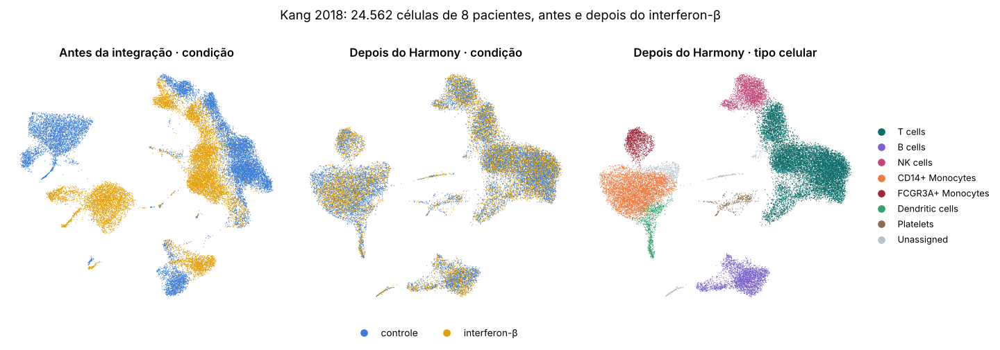
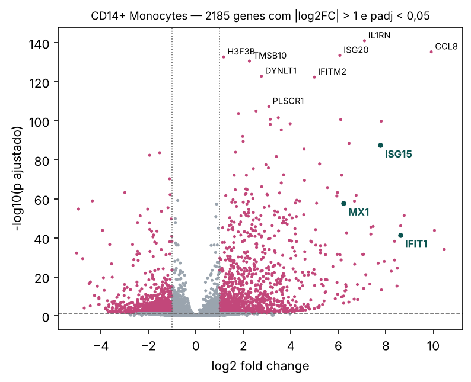

<p align="center">
  
</p>

<p align="center">
  <a href="CHANGELOG.md"></a>
  
  
  
  <a href="LICENSE"></a>
</p>

# ImmunoMap

**scRNA-seq com várias amostras: do arquivo bruto à resposta de cada tipo celular.**

O ImmunoMap é a continuação do [Cell-Atlas](https://github.com/rubenslyra/Cell-Atlas), que analisa uma amostra só. Aqui a pergunta muda: *o que muda nas células entre condições* (controle × estimulado, saudável × doente), separando o que é biologia do que é diferença técnica entre amostras.

```
arquivos (.h5ad · .h5 · .mtx · .csv) ──► QC por amostra ──► normalização + genes variáveis por lote ──► PCA
   └─ ou conjunto conhecido                                                                              │
                                                     Harmony (integração) ◄──────────────────────────────┘
                                                            │
                         Leiden + UMAP ──► anotação em grupos finos ──► pseudobulk ──► DESeq2 pareado
```

## Resultado de referência: Kang 2018

PBMC de 8 pacientes com lúpus, cada um em controle e estimulado com interferon-β por 6 horas: 16 amostras ([Kang et al., 2018](https://doi.org/10.1038/nbt.4042)). Um comando: `immunomap run --dataset kang2018`.

<p align="center">
  
</p>

| Indicador | Valor |
| --- | --- |
| Células após o controle de qualidade | 24.562 de 24.673, em 16 amostras |
| Mistura de amostras (sem integração → Harmony) | 0,61 → 0,79 |
| Separação de tipos (sem integração → Harmony) | 0,60 → 0,63 |
| Genes diferenciais nos monócitos CD14+ (padj < 0,05, \|log2FC\| > 1) | 2.185, o tipo que mais responde |
| ISG15 nos monócitos CD14+ | log2FC 7,8, cerca de 220 vezes mais expresso |
| Concordância com os rótulos dos autores | 91,1% |
| Tempo (2 núcleos de CPU) | 191 s (cerca de 3 minutos) na linha de comando; 266 s com `--jobs 1` ([onde vai o tempo](#onde-vai-o-tempo)) |

<p align="center">
  
</p>

Antes da integração, controle e estimulado formam ilhas separadas. Depois do Harmony, as células de mesmo tipo se juntam e a anotação fica comparável entre condições. A estatística, por sua vez, usa as **contagens brutas** por amostra, então o efeito do interferon não é apagado pela integração. Ele aparece no volcano: os genes estimulados por interferon (ISG15, MX1, IFIT1) sobem em todos os tipos celulares.

---

## Instalação

```powershell
cd D:\source\Academicos-Projetos\ImmunoMap
python -m venv .venv
.\.venv\Scripts\Activate.ps1
pip install -e ".[dev]"
pytest                      # confere a instalação
# opcional:
pip install -e ".[scvi]"    # integração com scVI (instala PyTorch, ~2 GB)
```

Requer Python ≥ 3.12. O 3.10 saiu de suporte em outubro de 2026 e, no 3.11, o pip entrega o scanpy 1.11.5, cujo gráfico chama uma função que o matplotlib 3.11 marcou como depreciada (os testes falham por isso). As dependências foram conferidas para Windows com Python 3.14: todas têm pacote pronto (wheel), então nada precisa de compilador.

**Versões:** o projeto usa as bibliotecas mais novas que foram testadas, e depreciação derruba os testes. Cada versão mínima tem um motivo e uma prova em [`docs/VERSOES.md`](docs/VERSOES.md), que também mostra quem ainda usa as versões anteriores e por quê.

## Uso

### Pelo navegador (também no tablet)

```powershell
immunomap app          # abre em http://localhost:8501
immunomap app --lan    # aceita o tablet na mesma rede: http://<IP-do-PC>:8501
```

Para descobrir o IP do PC, rode `ipconfig` e use o "Endereço IPv4". Na primeira vez, o Windows pode pedir para liberar o Python no firewall: permita só em **redes privadas**.

O app tem quatro passos, numa coluna só:

1. **Dados:** conjunto conhecido, arquivos enviados ou `.h5ad` já combinado (veja [Dados de entrada](#dados-de-entrada)).
2. **Parâmetros:** os principais estão na [tabela abaixo](#parâmetros).
3. **Rodar.**
4. **Resultados:**
   - Resumo e métricas de integração;
   - Mapa (antes e depois da integração);
   - Composição por amostra;
   - Expressão diferencial (volcano e tabela);
   - QC;
   - Baixar tudo em `.zip`.

### Pela linha de comando

```powershell
immunomap datasets                          # lista os conjuntos conhecidos
immunomap download kang2018                 # baixa e padroniza
immunomap run --dataset kang2018            # análise completa
immunomap run --samples amostras.csv        # seus arquivos, descritos numa planilha
immunomap run --input dados\brutos\kang_2018.h5ad --sample-col replicate --condition-col label --donor-col replicate
immunomap run --dataset pbmc_v2_v3 --integration none   # ver o efeito de lote sem correção
immunomap run --dataset pbmc3k --annotation-resolution 0.6 --seed 1   # ver o erro T CD8 → NK
python benchmarks/anotacao_pbmc3k.py                   # sementes × resolução da anotação
```

## Dados de entrada

Três formas, no app e na linha de comando:

| Forma | Quando usar | Na linha de comando |
| --- | --- | --- |
| **Conjunto conhecido** | Kang 2018, PBMC3k ou PBMC v2 × v3; baixado e guardado em `dados/` no primeiro uso | `--dataset kang2018` |
| **Um arquivo por amostra** | Saídas da 10x ou tabelas, descritas numa planilha | `--samples amostras.csv` |
| **`.h5ad` já combinado** | Todas as amostras num arquivo; você escolhe as colunas de amostra, condição e doador | `--input arquivo.h5ad --sample-col … --condition-col … --donor-col …` |

Formato da planilha ([`amostras.example.csv`](amostras.example.csv)):

| coluna | obrigatória | exemplo |
| --- | --- | --- |
| `sample_id` | sim | `P1_ctrl` |
| `condition` | sim | `ctrl` / `stim` |
| `path` | sim | arquivo `.h5ad`/`.h5`/`.csv` ou pasta `.mtx` (relativo à planilha) |
| `donor` | não | `P1`. Mesmo doador em duas condições ⇒ análise **pareada** |
| `format` | não | `auto`, `h5ad`, `10x-h5`, `10x-mtx`, `csv`, `tsv` |

Regras que protegem a análise:

- **Contagens brutas** (números inteiros) são obrigatórias. Dados já normalizados são recusados com uma mensagem explicando o motivo.
- **Uma condição por amostra.** Se a coluna escolhida como amostra for o paciente e ele aparecer nas duas condições (como no arquivo original do Kang, que só tem `replicate` e `label`), cada amostra é separada em `<paciente>_<condição>` e o paciente vira o doador. O app e o terminal avisam: "8 → 16 amostras".
- **Coluna de amostra precisa ser um nome, não uma medida.** Uma coluna que muda de célula para célula (`nCount_RNA`, código de barras) é recusada.

## Parâmetros

| No app | CLI / TOML | Padrão | O que faz |
| --- | --- | --- | --- |
| Colunas da amostra, condição e doador | `--sample-col`, `--condition-col`, `--donor-col` | sugeridas pelos nomes | Definem o desenho: o teste compara amostras, e o doador liga o antes e o depois do mesmo paciente |
| Integração entre amostras | `--integration` / `integration` | `harmony` | Alinha as amostras no PCA para o mesmo tipo celular ficar junto. `none` mostra o efeito de lote |
| Resolução do Leiden | `--resolution` / `resolution` | 0,6 | Zoom dos grupos mostrados no mapa |
| Resolução da anotação | `--annotation-resolution` / `annotation_resolution` | 1,5 | Grupos mais finos, usados só para dar nome aos tipos |
| Componentes principais | `n_pcs` | 30 | Dimensões que resumem os 2.000 genes mais variáveis |
| Mínimo e máximo de genes por célula | `min_genes_per_cell`, `max_genes_per_cell` | 200 e 6.000 | Tiram células vazias ou provavelmente duplas |
| Máximo de % mitocondrial | `max_mito_percent` | 15 | Tira células morrendo; só vale se o arquivo tiver genes `MT-` (o Kang não tem) |
| Semente | `--seed` / `random_state` | 0 | Mesmo resultado a cada execução |
| — | `--jobs` / `n_jobs` | 0 (todos os núcleos) | Quantos tipos celulares o DESeq2 analisa ao mesmo tempo. Cada processo extra usa até cerca de 360 MB; o principal chega a cerca de 2,3 GB no Kang 2018. Use 1 ou 2 se o computador tiver pouca memória |
| Expressão diferencial | `--no-de` desliga | ligada | Pseudobulk + DESeq2; precisa de pelo menos 2 amostras por condição em cada tipo |
| — | `min_cells_pseudobulk` | 10 | Mínimo de células para um grupo amostra × tipo entrar na estatística |
| — | `reference_condition` | primeira em ordem alfabética | Condição de referência do log2FC (no Kang, `ctrl`) |

Os mesmos parâmetros vão num arquivo: `immunomap run --dataset kang2018 --config immunomap.example.toml`.

## Conjuntos conhecidos

| chave | conjunto | amostras | pergunta | fonte |
| --- | --- | --- | --- | --- |
| `pbmc3k` | PBMC3k, 10x Genomics (2016) | 1 | O pipeline reencontra os tipos imunes? | `scanpy.datasets.pbmc3k()` |
| `kang2018` | Kang et al. 2018, lúpus + IFN-β | 16 (8 pacientes × 2) | Como cada tipo responde ao interferon? | cópia h5ad do scverse (a mesma do `pertpy`) · GEO GSE96583 |
| `pbmc_v2_v3` | PBMC em Chromium v2 e v3 | 2 | Quanto é efeito técnico (lote)? | 10x Genomics (pbmc8k, pbmc_10k_v3) |

Os downloads precisam de internet. Se algum endereço mudar, a mensagem de erro mostra qual URL falhou; ela fica em `src/immunomap/datasets.py`.

## Saídas

Para cada análise `<nome>`:

| Arquivo | Conteúdo |
| --- | --- |
| `resultados/<nome>/qc_por_amostra.csv` | células antes/depois do QC, mediana de genes e % mitocondrial |
| `resultados/<nome>/metricas_integracao.json` | mistura de amostras e separação de tipos, antes e depois |
| `resultados/<nome>/parametros.json`, `versoes.json` | parâmetros usados e versões do Python e das bibliotecas: a mesma entrada com as mesmas versões dá o mesmo resultado |
| `resultados/<nome>/composicao_por_amostra.csv` | % de cada tipo celular por amostra |
| `resultados/<nome>/pseudobulk_amostras.csv` | grupos amostra × tipo usados na estatística |
| `resultados/<nome>/expressao_diferencial.csv` | DESeq2 por tipo celular: log2FC, p, padj, desenho |
| `figuras/<nome>/*.png` | UMAP antes/depois, composição, volcano por tipo |
| `dados/<nome>_resultado.h5ad` | objeto completo para continuar no Python |

## Decisões de método

- **QC por amostra.** Cada amostra tem sua própria distribuição. O filtro de % mitocondrial só é aplicado se o arquivo tiver genes `MT-`.
- **Contagens brutas preservadas** em `layers["counts"]`: o pseudobulk soma contagens, não valores normalizados.
- **Genes variáveis por lote** (`batch_key=sample`): evita escolher genes que só diferenciam amostras.
- **Anotação em grupos finos.** O nome de cada tipo vem de um Leiden mais fino (`annotation_resolution` = 1,5) do que o do mapa (`resolution` = 0,6). Cada grupo recebe um nome só; se um grupo grosso junta T CD8 e NK, todos viram NK. Concordância com os rótulos de especialistas do PBMC3k, sementes 0 a 4 ([`benchmarks/anotacao_pbmc3k.py`](benchmarks/anotacao_pbmc3k.py)):

  | resolução da anotação | grupos | concordância média | pior semente |
  | --- | --- | --- | --- |
  | 0,6 | 7–9 | 87,9% | 82,6% |
  | 1,0 | 10 | 97,0% | 96,5% |
  | **1,5 (padrão)** | 12–13 | 97,4% | 96,9% |
  | 2,0 | 18–20 | 97,8% | 97,6% |

  A causa é a combinação de 30 componentes principais (padrão do ImmunoMap, pensado para conjuntos maiores) com a resolução 0,6: saem poucos grupos, e T CD8 e NK caem juntos. Com 10 componentes, como no Cell-Atlas, a resolução 0,6 fica estável (96,3–96,8%, `--n-pcs 10`). Anotando em 1,5, o resultado fica estável nos dois casos (96,7–97,8%).

  Lição: um número de acurácia só vale junto com os parâmetros e as sementes testadas. (Medido no Linux com scanpy 1.11; outras versões do igraph/scanpy mudam alguns décimos.)
- **Harmony** como padrão: rápido, roda na CPU e corrige o PCA sem mexer nas contagens. As métricas antes/depois mostram se ajudou.
- **Pseudobulk + DESeq2**: o teste compara **amostras**, não células. Assim, mil células de um paciente contam como um paciente, e não como mil réplicas. O desenho fica pareado (`~donor + condition`) quando cada doador aparece nas duas condições.

## Onde vai o tempo

Kang 2018 (24.673 células, 16 amostras), Linux com 2 núcleos. O Streamlit quase não pesa: a linha de comando leva o mesmo tempo.

| Etapa | 0.3.0 | 0.3.1 | Por quê |
| --- | --- | --- | --- |
| Expressão diferencial (DESeq2, 7 tipos) | 147 s | 87 a 100 s | Um modelo estatístico por tipo celular, com milhares de genes cada. Agora cada tipo roda num processo, em paralelo |
| Primeira busca de vizinhos | 30 s | 30 s; no app, em segundo plano | Quase tudo é compilação: o numba traduz o código do pynndescent para código de máquina uma vez por processo. O app faz isso ao abrir, enquanto você escolhe os dados |
| UMAP (antes e depois da integração) | 29 s | igual | Otimização iterativa do mapa em 2D, com semente fixa (roda num núcleo só) |
| Normalização, genes variáveis e PCA | 22 s | cerca de 13 s | PCA com `covariance_eigh`: exato como o `arpack` e cerca de 3 vezes mais rápido (11,8 → 3,6 s nesse tamanho) |
| Harmony | 15 s | igual (15 a 19 s entre execuções) | Alterna agrupamento e correção do PCA até as amostras se misturarem |
| Leitura, QC, Leiden, anotação, métricas e gravação | cerca de 25 s | cerca de 12 s | O Leiden do mapa "antes" deixou de rodar (era descartado). Parte da diferença é importação e leitura a frio na medição da 0.3.0 (cerca de 10 s), não do código |

Medido de ponta a ponta pela linha de comando (Kang 2018, 2 núcleos, arquivo local): 191,5 s com 2 processos e 265,6 s com `--jobs 1`. A rodada final da 0.3.2, com a mesma configuração, levou 184,3 s. No mesmo roteiro de medição, etapa por etapa, a 0.3.0 levou 268 s e a 0.3.1, 206 s (cerca de 12 s dessa diferença vêm de importação e leitura a frio na medição da 0.3.0). O 298 s que a linha de comando da 0.3.0 mostrou incluía o download do arquivo.

A primeira análise depois de instalar o pacote leva cerca de 77 s a mais: o cache em disco do numba ainda está vazio, e a primeira busca de vizinhos leva cerca de 106 s em vez de 30 s. Medido no Python 3.13 (105,9 s e 29,5 s) e no 3.14.6 (107,0 s e 29,8 s); as execuções seguintes usam o cache. Por isso a primeira rodada completa no 3.14 levou 253,2 s e a segunda, 190,7 s (o 3.13, com o cache pronto, 184,3 s): o Python 3.14 não é mais lento, o cache estava vazio (`provas/logs/2026-11-03/numba_real.txt`).

Os resultados não mudam: as 57.908 linhas da expressão diferencial saem idênticas às da 0.3.0, assim como os rótulos e as métricas. Com mais núcleos, a expressão diferencial tende ao tempo do tipo mais lento (cerca de 30 s, as células T). Os tempos variam cerca de 10% de uma execução para outra.

## Limitações conhecidas

- **Anotação por marcadores clássicos.** No Kang 2018 ela concorda 91,1% com os rótulos dos autores. As diferenças estão onde a biologia é parecida (parte das T CD8 vira NK, porque as duas são citotóxicas) e entre monócitos e células dendríticas.
- **Grupo com RNA de plaquetas.** 452 células recebem o nome "Platelets": 85% delas expressam PPBP, mas os autores as chamam de T ou monócitos. São, provavelmente, plaquetas grudadas em leucócitos, um artefato comum em amostras de sangue. Detecção de dupletos é o próximo passo.
- **"Unassigned".** Cerca de 3% das células ficam sem nome quando nenhum conjunto de marcadores se destaca no grupo. É uma escolha conservadora.
- **scVI** está disponível como opção, mas ainda não foi validado com dados reais.

## Desenvolvimento

```powershell
pytest        # 28 testes: leitores, planilha, desenho das amostras, pseudobulk, métricas, DESeq2 em paralelo = um de cada vez, pipeline ponta a ponta, CLI, app sem erro, e depreciação = falha
```

## Referências

- Kang, H. M. et al. Multiplexed droplet single-cell RNA-sequencing using natural genetic variation. *Nat. Biotechnol.* 36, 89 (2018). doi:10.1038/nbt.4042
- Korsunsky, I. et al. Fast, sensitive and accurate integration of single-cell data with Harmony. *Nat. Methods* 16, 1289 (2019). doi:10.1038/s41592-019-0619-0
- Luecken, M. D. et al. Benchmarking atlas-level data integration in single-cell genomics. *Nat. Methods* 19, 41 (2022). doi:10.1038/s41592-021-01336-8
- Squair, J. W. et al. Confronting false discoveries in single-cell differential expression. *Nat. Commun.* 12, 5692 (2021). doi:10.1038/s41467-021-25960-2
- Love, M. I., Huber, W. & Anders, S. Moderated estimation of fold change and dispersion for RNA-seq data with DESeq2. *Genome Biol.* 15, 550 (2014). doi:10.1186/s13059-014-0550-8
- Muzellec, B. et al. PyDESeq2: a python package for bulk RNA-seq differential expression analysis. *Bioinformatics* 39, btad547 (2023). doi:10.1093/bioinformatics/btad547
- Heumos, L. et al. Best practices for single-cell analysis across modalities. *Nat. Rev. Genet.* 24, 550 (2023). doi:10.1038/s41576-023-00586-w

Material de estudo comentado, com versões em português: [`docs/MATERIAL.md`](docs/MATERIAL.md).

---

<p align="center"><br>MIT · Rubens Lyra</p>
